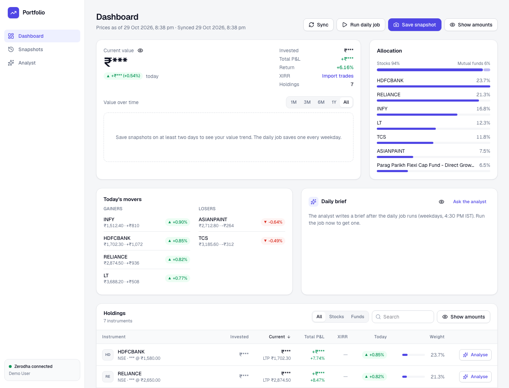
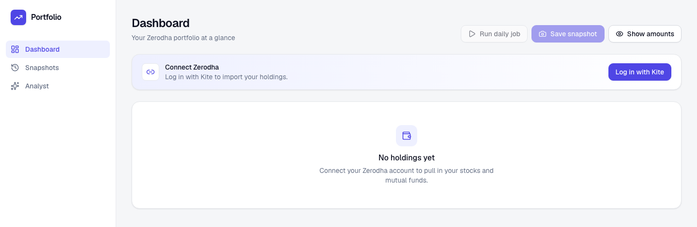
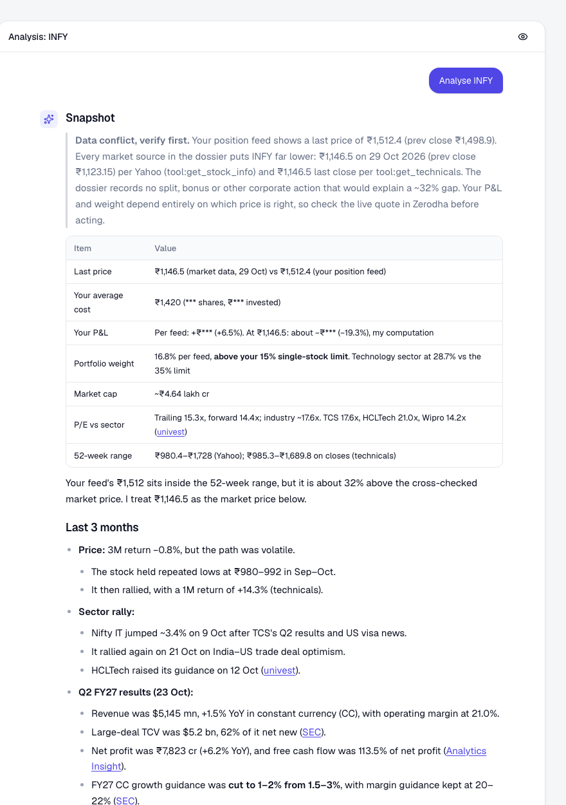
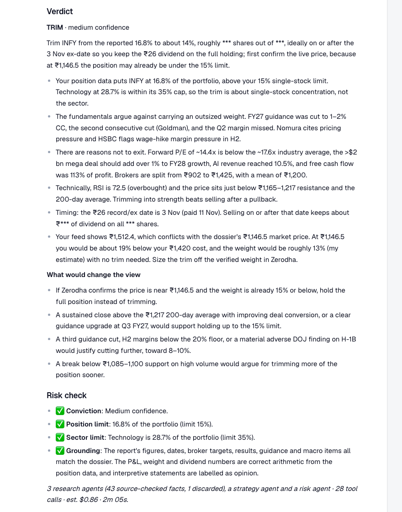

# Portfolio

Self-hosted Zerodha portfolio tracker with an AI analyst. It syncs your holdings through Kite
Connect, saves daily snapshots to Postgres, refreshes end-of-day prices on a schedule, computes
XIRR from your tradebook, and adds a Claude-powered analyst that can query your data, research any
holding on the web, and write a daily brief.

> **Not investment advice.** This is a personal, educational tool. The analyst's output is
> AI-generated, can be wrong or out of date, and is not a recommendation to buy or sell any
> security. Verify anything important yourself, and consult a SEBI-registered adviser for advice.



<sub>All screenshots use a demo database with made-up holdings. Amounts are hidden by default (privacy mode).</sub>

## What you need

- **Docker Desktop** (or Docker Engine with Compose v2): [docker.com/get-started](https://www.docker.com/get-started/).
- **A Zerodha account**, and a free **Kite Connect Personal** app to let this app read your holdings
  (step 2 below).
- **An Anthropic API key** for the AI analyst, Analyse and the daily brief
  ([console.anthropic.com](https://console.anthropic.com)). Optional: the tracker, snapshots and XIRR work
  without it. An Analyse run costs roughly $0.50–$1.50 (see [Costs](#costs)).
- **Optional:** a Slack Incoming Webhook if you want analyses and briefs posted to Slack.

```
apps/
  api/   FastAPI + SQLAlchemy (Python 3.12): Kite sync, prices, snapshots, AI agents, scheduler
  web/   Next.js 16 (App Router): dashboard, snapshots, analyst chat; proxies /api/* to the API
infra/postgres/  init script (creates the agent's read-only DB role)
docker-compose.yml  db · api · worker · web
```

## Setup

### 1. Get the code

```bash
git clone https://github.com/kumarshivam675/zerodha-portfolio.git portfolio
cd portfolio
cp .env.example .env
```

### 2. Create a Kite Connect app

Kite Connect is Zerodha's official API. The **Personal** plan is free and gives read access to your own
holdings. It has no market data, which is why prices come from Yahoo Finance.

1. Go to [developers.kite.trade](https://developers.kite.trade) and sign up or log in. The developer
   console has its own account, separate from your trading login.
2. Choose **Create new app** and pick the **Personal** type.
3. Fill in:
   - **App name:** anything, e.g. `Portfolio`.
   - **Zerodha Client ID:** your trading account's user ID (e.g. `AB1234`).
   - **Redirect URL:** `http://localhost:3300/api/kite/callback`. It must match exactly, including the port.
   - **Postback URL:** leave empty.
4. Create the app, then copy its **API key** and **API secret**.

### 3. Fill in `.env`

Open `.env` in an editor. Only the first three are needed to get started:

| Variable | What to put |
|---|---|
| `KITE_API_KEY`, `KITE_API_SECRET` | From the Kite app in step 2. |
| `ANTHROPIC_API_KEY` | From [console.anthropic.com](https://console.anthropic.com) → API keys. Leave empty to run without the AI features. |
| `POSTGRES_PASSWORD`, `AGENT_DB_PASSWORD` | Change both to random strings **before the first start**. They are only read when the database is created. |
| `SLACK_WEBHOOK_URL` | Optional. A Slack [Incoming Webhook](https://api.slack.com/messaging/webhooks) URL. |
| `WEB_PORT`, `WEB_URL` | Only if port 3300 is taken. Update the Kite redirect URL to match. |

Everything else has sensible defaults, documented in `.env.example`.

### 4. Start it

```bash
docker compose up -d --build
```

The first build takes a few minutes. Then open **<http://localhost:3300>**:



### 5. Connect Zerodha

Click **Log in with Kite**. You'll log in on Zerodha's own site (with your usual 2FA), then land back
on the dashboard with your holdings imported. The app never sees your Zerodha password.

**Kite sessions expire every day at about 6 AM IST.** That's a Zerodha rule. Log in again whenever you
want fresh holdings. Prices keep refreshing on their own, from Yahoo Finance, either way.

### 6. Optional next steps

- **XIRR:** Kite's API has no trade history, so download your tradebook from
  [Console](https://console.zerodha.com) → Reports → Tradebook (one CSV per financial year, equity
  segment) and import it from the dashboard.
- **Analyse a holding:** click **Analyse** on any row of the holdings table. Research agents gather and
  source-check the facts, a strategy agent writes the report and verdict, and a risk agent checks it
  against your limits and the sources. A run takes 3–5 minutes.

  

  The report ends with the verdict and the risk check that let it through:

  

  <sub>Demo data: the made-up holding's price disagrees with the market, and the agent flags it
  instead of glossing over it.</sub>
- **Daily brief and snapshots:** the `worker` runs a daily job (default 4:30 PM IST, Mon–Fri) that
  refreshes prices, saves a snapshot and writes a brief. Use **Run daily job** to run it now.

### Troubleshooting

| Problem | Fix |
|---|---|
| Kite says the redirect URL is invalid, or you land on an error page after logging in | The Kite app's Redirect URL must be exactly `http://localhost:3300/api/kite/callback` (or your `WEB_URL` + `/api/kite/callback`). |
| Dashboard says "Zerodha isn't configured" | `KITE_API_KEY` / `KITE_API_SECRET` are empty. Fill them in, then `docker compose up -d`. |
| Holdings stopped updating | Your Kite session expired (daily, ~6 AM IST). Click **Log in with Kite** again. |
| Port 3300 (or 8000/5433) already in use | Set `WEB_PORT` and `WEB_URL` in `.env` and update the Kite redirect URL; for the others, change the port mappings in `docker-compose.yml`. |
| "Too many analyses running" | At most `MAX_CONCURRENT_ANALYSES` (default 2) run at once. Wait, or stop one with the ■ button. |
| Analyse or chat says `ANTHROPIC_API_KEY is not set` | Add the key to `.env`, then `docker compose up -d`. |
| Changed the Postgres passwords after the first start and now nothing connects | They only apply to a new database. Put the old ones back, or reset with `docker compose down -v` (this **deletes** your data). |
| Anything else | `docker compose logs -f api worker` usually says what went wrong. |

### Updating, stopping and backups

```bash
git pull && docker compose up -d --build     # update; database migrations run automatically
docker compose down                          # stop (your data stays in the pgdata volume)
docker compose exec db pg_dump -U portfolio portfolio > backup.sql   # back up
```

## How it works

| Piece | What it does |
|---|---|
| Zerodha login | `/api/kite/login` → Kite → `/api/kite/callback` stores the access token and syncs holdings (equity + mutual funds). Kite tokens expire every day at ~6 AM IST, so log in again to refresh holdings. |
| Snapshots | **Save today's snapshot** freezes the current holdings for today's date (saving again the same day replaces it). The daily job also saves one automatically (`AUTO_SNAPSHOT`). |
| Daily job (`worker`) | Runs at `DAILY_JOB_CRON` (default 16:30 IST, Mon–Fri): re-syncs from Zerodha if today's session is valid, downloads EOD candles from Yahoo Finance for every stock, reprices holdings, saves a snapshot, then has the analyst write a **daily brief** (`AUTO_BRIEF`). Trigger it manually from the dashboard. |
| Privacy mode | Position-sized amounts (values, invested, P&L, quantities) show as `***` by default. Any eye button reveals them on every screen; the choice is remembered per browser. Percentages, market prices, average cost and today's movers stay visible. In the analyst's replies, only figures it tags as yours (`{{…}}`) are hidden, so prices, targets and recommendations stay readable. Handy for screenshots and screen shares. |
| XIRR | Kite's API has no XIRR or trade history (only today's trades), so import your **Console → Reports → Tradebook** CSVs (one per year) from the dashboard. XIRR is calculated per holding and for the portfolio from those cash flows plus today's value. New trades are picked up on every Zerodha sync. Holdings the tradebook only partly explains (older trades, bonus/split, transfer-in) are marked ≈. Dividends aren't included. |
| Analyse (holdings table) | Each holding has an **Analyse** button. It opens a side panel and runs a multi-agent pipeline (see [Analyse pipeline](#analyse-pipeline)) that ends with a report and a verdict for your position: 3- and 6-month price action, technicals (computed server-side), fundamentals, company news, and macro/geopolitical drivers. You can ask follow-ups in the panel, and each analysis is saved in the Analyst history. |
| Slack notifications | Set `SLACK_WEBHOOK_URL` (a Slack Incoming Webhook) to get a message for every analyst answer (Analyse runs, Analyst-page questions, follow-ups) and every **daily brief**. Long reports arrive as a one-minute digest (verdict and confidence, key figures, 3–4 short sections, what to watch) written by `SLACK_DIGEST_MODEL`, with a link to the full report in the app; short answers arrive as-is. Your own figures are masked (`SLACK_HIDE_AMOUNTS`). Test with `curl -X POST localhost:3300/api/slack/test`. |
| Analyst | Claude (`AGENT_MODEL`, default `claude-opus-5-5`) with tools for portfolio, snapshots, price history, stock fundamentals, read-only SQL, plus web search/fetch. Conversations are stored in Postgres. |

### Data notes and limits

- **Prices come from Yahoo Finance**, not Kite: the free Kite Personal API has no market-data
  endpoints. To use Kite quotes and history instead, you'd need the paid ₹500/month Connect plan.
- Mutual fund NAVs only update when you sync from Zerodha.
- The agent's SQL tool connects as a separate `agent_ro` Postgres role. That role has SELECT access to
  the portfolio tables only, so it can't read the stored Kite token or write anything.
- There's no login on the web app. All ports bind to `127.0.0.1` only, so keep it local or put auth
  in front before exposing it.
- The schema is managed by Alembic migrations, applied automatically on startup (see [Development](#development)).

### Analyse pipeline

Analyse is a multi-agent pipeline (`apps/api/app/services/analysis/`). Each agent does one job and gets
only the tools that job needs. The decision passes a risk gate before anyone sees it.

```
   ┌─ company & news research ─┐  checked
 ──┼─ technical research ──────┼─ facts ──► strategy ──► risk gate ──► report (+ Slack)
   └─ macro research ──────────┘              ▲              │
                                              └── revise ────┘  (once)
```

| Agent | Model | Tools | Job |
|---|---|---|---|
| Research (3 in parallel; fund + macro for mutual funds) | `RESEARCH_MODEL` (Sonnet) | Company: fundamentals and web. Technicals: computed indicators and price history, no web. Macro: web. None of them can see your portfolio. | Gather dated facts with sources, submitted through a strict schema. Never recommend. |
| Strategy | `STRATEGY_MODEL` (Opus) | None | Write the report and a structured verdict (action, confidence, target weight, reasons, triggers) from the source-checked facts and your position only. |
| Risk | Plain code + `RISK_MODEL` (Opus) | None | Enforce the portfolio limits in code, and check every material claim against the source-checked facts. |

How the pipeline keeps the agents honest:

- **Sources are checked in code.** A fact citing a URL is kept only if that agent's own
  `web_search`/`web_fetch` calls returned that URL, so invented links are discarded before the strategy
  agent sees them. A fact citing a tool is kept only if the agent called that tool successfully, and it
  is labelled as computed when its figures are not in the tool's output. This proves *where* a fact came
  from, not that it was copied correctly: a wrong figure attributed to a real page gets past this check.
  Catching that is the job of the risk agent's grounding review, which compares the report against these
  facts, and ultimately of the reader, since every fact links to its source.
- **The verdict is data, not prose.** The strategy agent returns its verdict as structured output. The
  report's Verdict section is rendered from the verdict *after* the risk gate, so a blocked "add" can
  never reach the report or Slack as "add".
- **The limits are code, and fail closed.** No "add" above `RISK_MAX_POSITION_PCT` in one stock or
  `RISK_MAX_SECTOR_PCT` in one sector. No "add" on low confidence, without a target weight, or when the
  position or sector can't be determined. ETFs and mutual funds are exempt from the weight limits.
- **Unsupported claims cost the verdict.** If the grounding review still finds unsupported claims after
  one revision, the verdict becomes a low-confidence HOLD, whatever was proposed, and the claims are
  listed in the report.
- **Web content is untrusted.** Every prompt treats pages and search results as data, never as
  instructions. The strategy agent, which makes the decision, has no tools at all.
- **Runs are bounded.** Each run has a cost budget (`ANALYSIS_BUDGET_USD`; any model it doesn't know the
  price of is costed at the highest known rate), each research agent has a
  deadline, transient API errors are retried with backoff, and at most `MAX_CONCURRENT_ANALYSES` run at
  once. Runs can be cancelled from the UI (`POST /api/agent/conversations/{id}/cancel`); this stops
  every agent.

Every run is recorded in `agent_runs` (status, tokens, estimated cost). If the API restarts mid-run,
the run is marked interrupted and its conversation says so. Every agent turn and result is stored in
`agent_steps` and served at `GET /api/agent/conversations/{id}/steps`, so you can see why a verdict
came out the way it did. The model-driven parts are measured by evals in
[`apps/api/evals`](apps/api/evals/README.md).

## Costs

- **Zerodha:** the Kite Connect Personal API is free. Holdings, orders and portfolio data are
  included; market data isn't, which is why prices come from Yahoo Finance.
- **Anthropic:** you pay per token on your own API key. A chat question is usually cheap. An **Analyse**
  run costs about $0.50–$1.50: the three research agents make 30–60 tool calls between them on Sonnet,
  including web searches ($10 per 1,000), then the strategy and risk agents run on Opus. A run takes 3–5
  minutes. The app estimates each run's cost from token usage, shows it in the analysis panel and report
  footer, and stops a run that passes `ANALYSIS_BUDGET_USD` (default $4). The daily brief runs once per
  weekday. To cut costs, lower `RESEARCH_EFFORT`, set `STRATEGY_MODEL`/`RISK_MODEL`/`AGENT_MODEL` to
  `claude-sonnet-5-5`, or set `AUTO_BRIEF=false`. Check actual spend in the Anthropic Console.

## Security and privacy

- Everything runs on your machine. Your holdings, trades and conversations live in a local Postgres
  volume. Anthropic receives what the analyst sends it (portfolio figures and your questions) to
  answer you.
- Keep `.env` out of version control (it is git-ignored). If a key leaks, regenerate it in the
  Kite developer console or Anthropic Console.
- The app has **no login**. Ports bind to `127.0.0.1` only. Don't expose it to a network without
  putting authentication in front.
- Because there is no login, the app only answers to `localhost`-style Host names, which blocks DNS
  rebinding: a malicious page can't read your data through your browser. Add other names to
  `ALLOWED_HOSTS` (web) and `API_ALLOWED_HOSTS` (API) only if you put authentication in front. The API
  also refuses state-changing requests that a browser marks as coming from another site (`Origin` /
  `Sec-Fetch-Site`), so a web page you visit can't trigger analyses, syncs or Slack posts.
- The analyst reads web pages, which can contain prompt-injection attempts. Prompts treat web content as
  data. The SQL tool connects as a read-only role that can't see Kite tokens. The web fetch tool can only
  open URLs that already appear in the conversation, which limits exfiltration. The Analyse strategy
  agent has no tools. The chat analyst and daily brief do combine portfolio access with web tools, so
  read their output with that in mind.
- Yahoo Finance data is for personal use; don't redistribute it, and don't redistribute Kite API data
  (exchange data-vending rules).

## Useful commands

```bash
docker compose logs -f api worker        # backend + scheduler logs
docker compose exec db psql -U portfolio # SQL shell (also on 127.0.0.1:5433)
curl -X POST localhost:3300/api/jobs/daily/run   # run the daily job now
```

## Development

CI (`.github/workflows/ci.yml`) runs on every push and pull request. It runs ruff, mypy and pytest for
the API, checks that the migrations apply and match the models, and runs eslint and `tsc` for the web
app. To run the same checks locally against the Docker stack:

```bash
docker compose run --rm --no-deps -v "$PWD/apps/api:/src" -w /src --entrypoint sh api -c '
  pip install -q -r requirements-dev.txt && export PATH=$HOME/.local/bin:$PATH &&
  ruff check . && ruff format --check . && mypy && pytest'
(cd apps/web && npm run lint && npm run typecheck)
```

- **Tests** (`apps/api/tests`) need no API key or database. The agent loop is replayed against recorded
  API responses. The pipeline, risk rules, source verification and run management are tested with Claude
  stubbed out.
- **Evals** (`apps/api/evals`) call the real API to measure the model-driven parts, such as whether the
  grounding review catches planted fabrications. See [its README](apps/api/evals/README.md).
- **Migrations:** the API migrates the database on startup (Alembic, `apps/api/app/migrations`). After
  changing `models.py`, generate a migration with
  `docker compose run --rm -v "$PWD/apps/api:/src" -w /src api alembic revision --autogenerate -m "..."`.

## License

[MIT](LICENSE)
